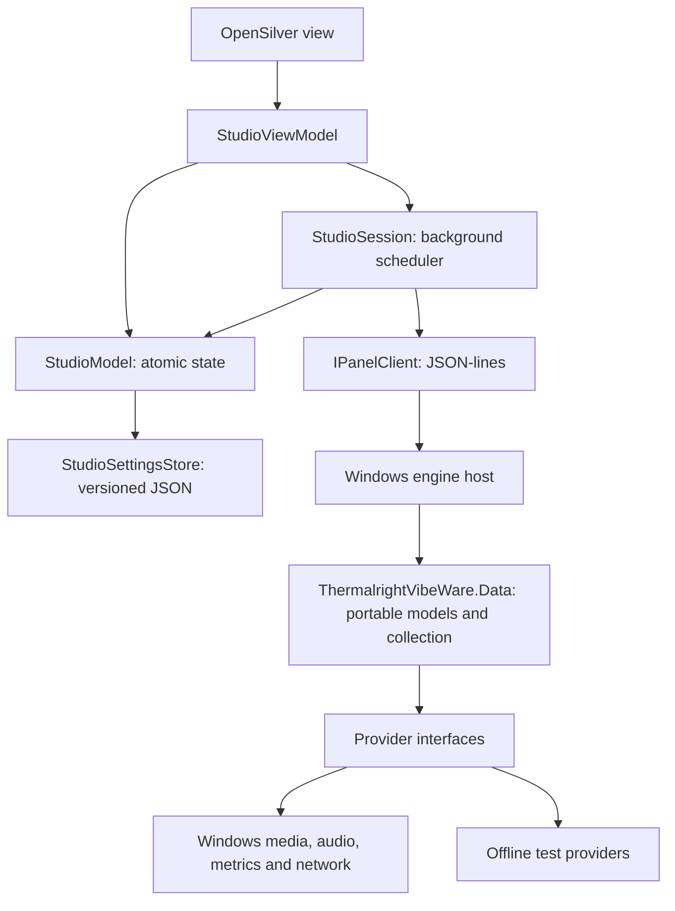

# Studio state and provider boundaries

The display loop belongs to `StudioSession`, not the window. Closing a preview, hiding the window or blocking its dispatcher must not stop an active output session.

## State and persistence

`StudioModel.Update` commits preferences, screen choices and palette overrides under one lock. Editors and readers receive detached copies. A failed edit commits nothing. Each frame takes one copy, including its palette and screen selections. Automatic rotation checks the observed revision before committing, so it cannot overwrite a newer user edit.

`StudioViewModel` owns catalog normalization and selection commands. It also exposes typed font, Codex and diagnostics operations and their latest results. The view keeps native controls, layout and temporary dialogs; it does not send raw protocol method names. `StudioSession` owns output scheduling and engine serialization.

`StudioSettingsStore` reads at most 1 MiB and writes `schemaVersion: 1`. Unversioned settings are rejected and left untouched. A save flushes a temporary file, then atomically replaces the current file and preserves its previous contents as `.bak`. A corrupt file falls back to a valid backup. Recovery does not replace that good backup with corrupt data. Unsupported versions and unrecoverable files are left untouched, with a visible notice; saving remains disabled for that session. Runtime revisions and timestamps are not persisted.

`StudioPreferences.IsFirstRun` defaults to `true` and is stored as `isFirstRun` in the same versioned file. The first Windows launch shows the studio even when sign-in passes tray arguments. Once the main page has loaded, `StudioModel.CompleteFirstRun` saves a detached state with the flag set to `false`, then publishes it. A failed save leaves the flag true and reports a notice. Later Windows launches start in the tray; Open, About and ordinary activation still restore the existing window. Without a working tray, the host keeps its visible-window fallback.

See [Code maintenance](code-maintenance.md) for the source file map and documentation conventions.

## Platform boundary

`ThermalrightVibeWare.Data` targets plain `net10.0`. It holds data records, provider interfaces and the shared collection service. It references no Windows APIs or hardware libraries.  `WindowsDashboardProviders` is the Windows composition root. The host explicitly supplies these providers; constructing the data service does not choose or open hardware. Disabled features do not read their providers. A failed playback provider cannot discard available media or sensor results.

This is a portable data boundary, not a Linux or macOS hardware backend. The engine host, USB transport, system providers and raster conversion remain Windows-specific. The non-Windows desktop runtime is not yet a complete working studio. Linux CI builds the UI and executes model, persistence and fake-provider checks. No test opens USB, sensors or audio. These checks do not establish physical-device or installer behavior.
